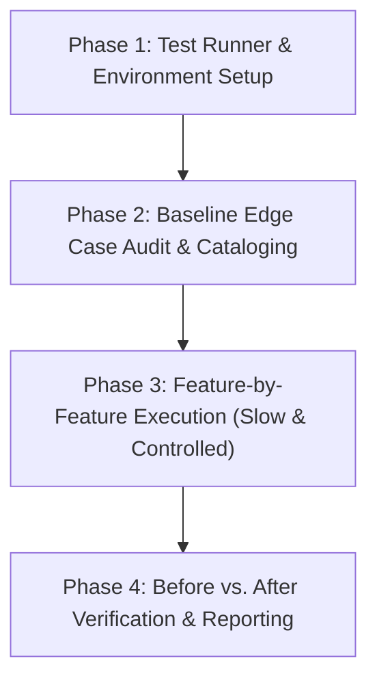

# Blueprint & Implementation Plan: Feature-by-Feature Testing & Edge Case Discovery

> **Scope:** Frontdesk Dashboard (`frontdesk-fitflix`) & Backend (`FITFLIX_BACKEND`)  
> **Exclusions:** Zego Cloud video streaming & WebRTC components.  
> **Core Rule:** Uncover failure points and edge cases, document them in `DISCOVERED_EDGE_CASES.md` with use case and expected behavior, but **DO NOT modify or fix any edge cases without explicit user permission**.

---

## High-Level Execution Phases

---

## Phase 1: Test Harness & Environment Setup
*Objective: Give Frontdesk a fast, lightweight test runner compatible with Next.js 15 and React 19 without touching production application code.*

1. **Step 1.1 — Select & Configure Frontend Test Harness**
   - Install minimal Vitest + React Testing Library dependencies in `frontdesk-fitflix`.
   - Configure `vitest.config.ts` with path alias support (`@/*`).
   - Add `"test": "vitest run"` and `"test:watch": "vitest"` to `package.json`.

2. **Step 1.2 — Setup Mock & Test Utility Infrastructure**
   - Setup a test query client wrapper (`QueryClientProvider` with 0 retries).
   - Setup Axios mock handler for `apiClient` to simulate backend HTTP responses without needing live databases.
   - Setup localStorage / cookie mock shims for auth state.

3. **Step 1.3 — Create Discovered Edge Cases Register**
   - Initialize `DISCOVERED_EDGE_CASES.md` to log all gaps, contract mismatches, and edge failures across both repos.

---

## Phase 2: Feature-by-Feature Execution Order

Features will be audited and tested **one at a time in sequence**. For each feature:
1. **Audit:** Trace contract between Frontend Service (`frontdesk-fitflix/lib/services/*.ts`) and Backend Controller (`FITFLIX_BACKEND/src/controllers/*.ts`).
2. **Catalog Edge Cases:** Identify unhandled error codes, missing inputs, race conditions, or null states. Log to `DISCOVERED_EDGE_CASES.md`.
3. **Write Unit/Integration Tests:** Test before/after states, error handling, cache updates, and mutations.
4. **Report to User:** Present findings and ask for permission before touching any code logic.

### Sequenced Feature Roadmap:

| Sequence | Feature Area | Key Files Involved | Status | Primary Focus |
|---|---|---|---|---|
| **Step 1** | **Authentication & RBAC** | `auth.service.ts`, `auth-context.tsx`, `middleware.ts` | **Completed** (EC-001–004) | Token expiry, 401 interceptor, role redirection (`clinic_admin` vs `staff`), localStorage sync |
| **Step 2** | **New Sales & Invoicing** | `invoice.service.ts`, `invoices/page.tsx`, `sales/page.tsx` | **Completed** (EC-005–008) | Walk-in lead vs existing user, discount validation, tax calculation, payment status transitions (PAID atomic lock) |
| **Step 3** | **Memberships & Renewals** | `membership.service.ts`, `memberships/page.tsx`, `renewals/page.tsx` | **Completed** (EC-009–013) | Active/Expired/Paused states, overlap date validation, remaining credits deduction |
| **Step 4** | **Leads & Pipeline** | `lead.service.ts`, `leads/page.tsx` | **Completed** (EC-014–017) | Lead capture, phone normalization (last 10 digits), status transitions (`New` → `Qualified` → `Converted`), duplicate phone handling |
| **Step 5** | **Onboarding Timeline** | `onboarding.service.ts`, `onboarding-timeline.tsx`, `users/page.tsx` | **Completed** (EC-018–020) | 5-step status tracking, missing step alerts, read-only admin visibility |
| **Step 6** | **Slots & Attendance** | `slot.service.ts`, `slots/page.tsx`, `attendance/page.tsx` | **Completed** (EC-021–023) | Overbooking, capacity countdown, attendance marking (`Attended`, `Unattended`, `Cancelled`) |
| **Step 7** | **Doctor & Nutritionist Appointments** | `appointment.service.ts`, `nutritionist-booking.service.ts` | **Completed** (EC-024–025) | Slot conflict detection, appointment rescheduling, status sync |
| **Step 8** | **Credits & Ledger** | `credit.service.ts`, `credits/page.tsx` | **Completed** (EC-026–029) | Admin top-up, credit consumption ledger, negative balance prevention |
| **Step 9** | **Workout Plan Builder (Client-side)** | `workout-plan.service.ts`, `stores/workout-store.ts` | **Completed** (EC-030–032) | LocalStorage persistence, draft workouts, exercise reordering, unsaved changes warning |
| **Step 10** | **Services & Therapies Catalog** | `service.service.ts`, `therapy.service.ts`, `services/page.tsx` | **Completed** (EC-033–035) | Frontdesk role 403 on `/services` and `/therapies`, orphaned bookings upon service deletion |
| **Step 11** | **Dashboard Overview & Alerts** | `dashboard.service.ts`, `overview/page.tsx` | **Completed** (EC-036–038) | Contract shape mismatch (zero revenue bug), client alert dismissal persistence |
| **Step 12** | **Admin Settings & Permissions** | `settings.service.ts`, `settings/page.tsx` | **Completed** (EC-039–040) | Unguarded global settings endpoints (`PUT /rooms`), role escalation limits |
| **Step 13** | **Trainer Member Roster & PT Status** | `trainer-workout.service.ts`, `workouts/members/page.tsx` | **Completed** (EC-041–042) | Expired membership ghosting on trainer roster, coverage/relief trainer access blocks |
| **Step 14** | **PT Session Logging & Set Recording** | `trainer-workout.service.ts`, `use-member-workout.ts` | **Completed** (EC-043–044) | 409 Conflict lockout on completed sessions, staff actor model misattribution |
| **Step 15** | **Workout Plan Assignment & Calendar** | `workout-plan.service.ts`, `assign-plan-sheet.tsx` | **Completed** (EC-045–046) | Frontdesk role block on plan assignment, multi-user assignment partial failure tracking |

*(Note: Zego video calling and live stream sessions are explicitly excluded.)*

---

## Phase 3: The 4-Step Standard for Every Feature

For each feature in the list above, we follow this exact cycle:

### 1. Contract & Edge Audit
- Compare Frontend TypeScript types with Backend Zod validation schemas.
- Identify edge conditions:
  - Network timeout / 500 server crash
  - Validation failure (400 `VALIDATION_ERROR`)
  - Duplicate key error (409 `CONFLICT` or MongoDB 11000)
  - Missing optional fields or null references

### 2. Edge Case Recording (No fixes without permission)
- If an edge case or mismatch is found, it is added to `DISCOVERED_EDGE_CASES.md`:
  - **Feature Name & Use Case**
  - **What currently happens** (e.g. infinite spinner, unhandled 500 toast, missing validation)
  - **What the expected behavior should be**
  - **Status:** Pending User Approval

### 3. Write Isolated Tests (Before vs. After)
- Test creation:
  - *State Before:* Initial empty/loading cache.
  - *Action:* Trigger mutation (e.g. create sale, update status).
  - *State After:* Assert cache invalidation, table row update, toast message trigger.

### 4. User Review Checkpoint
- Present the results to the user with a diff summary.
- Ask for explicit permission before attempting to write any bug fix or edge case resolution.
